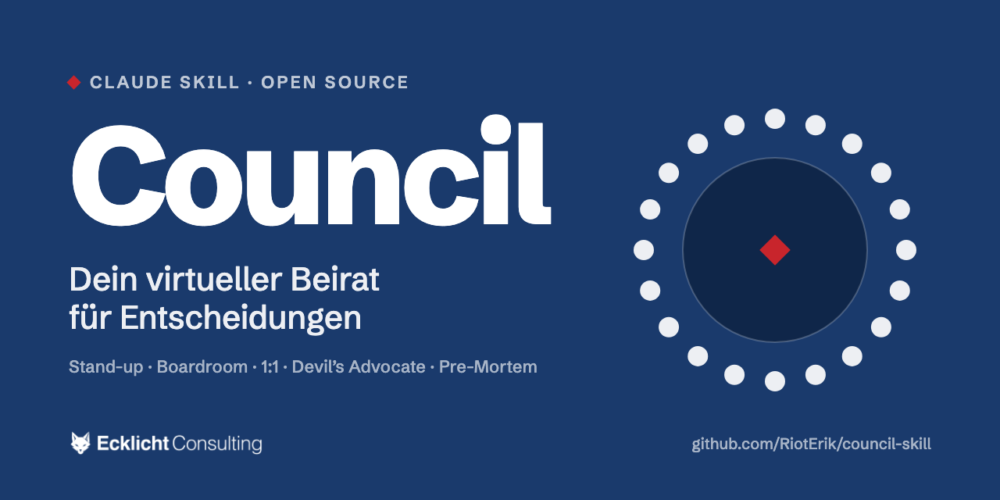

<p align="center"></p>

# Council: dein virtueller Beirat für Claude

Du stehst vor einer Entscheidung und willst sie aus mehr als einer Richtung durchdenken? Das Council setzt zwölf Beiräte an einen Tisch: Produkt, Marke, Geld, Verhandlung, Sichtbarkeit, Conversion, Ethik und Familie. Sie debattieren deine Frage, und am Ende steht eine klare Empfehlung mit nächsten Schritten, Risiko und offenen Punkten.

> **In short (English):** Council is a skill for Claude Code that turns one question into a board meeting. Twelve advisors argue from their own angle: some carry the names of historical or fictional figures, the others are archetypes modelled on well-known schools of thought. You get a Markdown file with distinct voices, visible disagreements and a recommendation (decision, actions, risk, open questions). Skill and personas are written in German. Ask in English and the council answers in English.

## Was das Council macht

Claude ist der KI-Assistent von Anthropic. Ein Skill ist eine Arbeitsanleitung, die Claude bei passenden Fragen automatisch nutzt. Dieser Skill macht Claude zum Moderator eines Beirats.

So läuft eine Sitzung ab:

1. Du stellst deine Frage in normaler Sprache, zum Beispiel: „Frag das Council: Soll ich diesen Auftrag annehmen?“
2. Claude wählt die passenden Beiräte und einen Modus.
3. Jeder Beirat argumentiert aus seiner Sicht, mit eigener Stimme und klarer Position.
4. In Boardroom und Devil's Advocate antworten die Beiräte in einer zweiten Runde direkt aufeinander und stimmen ab. Widersprüche bleiben sichtbar.
5. Am Ende steht eine Empfehlung: Entscheidung, nächste Schritte, Risiko, offene Fragen. Alles landet als Datei auf deinem Rechner.

## Beispiel: Ein Großkunde will 20 Prozent Rabatt

*Erfundenes Beispiel, gekürzt. Es zeigt Aufbau und Ton einer Session.*

**Frage**: Ein Großkunde bietet einen Rahmenvertrag über drei Jahre an und verlangt dafür 20 Prozent Rabatt auf alle Leistungen. Annehmen?
**Modus**: Boardroom
**Besetzung**: Value-Investor (Marge und Abhängigkeit), Harvey Specter (Verhandlung), Andrew Grove (Kapazität), Sun Tzu (Position), David Ogilvy (Preis als Markensignal)

**Der Value-Investor**: Rechne zuerst, was nach dem Rabatt übrig bleibt. Liegt deine Marge heute bei 30 Prozent, bleiben dir zehn. Für drei Jahre Planungssicherheit kann das reichen, solange dieser Kunde höchstens ein Drittel deines Umsatzes ausmacht. Liegt er darüber, verkaufst du mit dem Rabatt deine Unabhängigkeit.

**Harvey Specter**: 20 Prozent sind ein Eröffnungsangebot. Behandle es so. Rabatt gibt es nur gegen Gegenleistung: Vorauszahlung, Mindestvolumen, Referenz. Und kläre vorher, was du tust, wenn er Nein sagt. Ohne Alternative bist du der Bittsteller.

**Andrew Grove**: Was bindet der Vertrag an Kapazität? Drei Jahre mit gedrückter Marge heißen weniger Luft für bessere Kunden. Leg eine Kennzahl fest, ab der neu verhandelt wird, und schreib sie in den Vertrag.

**Sun Tzu**: Wer zuerst nachgibt, legt den Preis für alle künftigen Runden fest. Finde heraus, warum der Kunde gerade jetzt bündeln will. Oft steht er unter mehr Druck als du.

**David Ogilvy**: Ein Rabatt erzählt eine Geschichte über deine Marke. Gib ihm einen Namen und Bedingungen, etwa als Treuerabatt, damit dein Listenpreis seinen Wert behält.

**Runde 2** (Auszug)
- **Harvey Specter an den Value-Investor**: Du rechnest, als stünde der Rabatt schon fest. Er ist erst ein Angebot, und jede Gegenleistung schiebt deine Marge wieder nach oben.
- **Der Value-Investor an Sun Tzu**: Den Druck auf Kundenseite herauszufinden ist klug, ersetzt aber keine Rechnung. Auch ein Kunde unter Druck hält dich in der Hand, wenn er ein Drittel deines Umsatzes ausmacht.
- **David Ogilvy an Harvey Specter**: Bei den Gegenleistungen bin ich bei dir. Du übersiehst, dass sich ein Rabatt herumspricht: Was dieser Kunde bekommt, verlangen die nächsten auch.

**Abstimmung**

| Beirat | Votum | Zuversicht (1 bis 10) | Entscheidende Bedingung |
|--------|-------|-----------------------|-------------------------|
| Der Value-Investor | Ja, wenn … | 6 | Marge bleibt zweistellig, Kunde unter einem Drittel des Umsatzes |
| Harvey Specter | Ja, wenn … | 8 | Rabatt nur gegen Vorauszahlung, Mindestvolumen und Referenz |
| Andrew Grove | Ja, wenn … | 5 | Kennzahl für Neuverhandlung steht im Vertrag |
| Sun Tzu | Nein | 6 | Die 20 Prozent nie als Ausgangspunkt annehmen, erst Gegenangebot |
| David Ogilvy | Ja, wenn … | 7 | Rabatt läuft als benannter Treuerabatt, der Listenpreis bleibt |

**Spannungen**
- Value-Investor und Grove sehen vor allem das Risiko der Abhängigkeit, Specter und Sun Tzu vor allem den Verhandlungsspielraum.
- Ogilvy will den Listenpreis schützen. Specter würde ihn opfern, wenn die Gegenleistung stimmt.

**Empfehlung**
- **Decision**: Gegenangebot mit gestaffeltem Rabatt: zehn Prozent im ersten Jahr, bis zu 15 Prozent ab einem Mindestvolumen, gegen Vorauszahlung und Referenz.
- **Action**: Marge nach Rabatt und Umsatzanteil des Kunden ausrechnen. Eigene Alternative festlegen, falls der Kunde ablehnt. Gegenangebot mit Bedingungen formulieren und als Treuerabatt benennen.
- **Risk**: Der Kunde wächst auf mehr als ein Drittel deines Umsatzes. Lackmustest: Würdest du zu diesen Konditionen auch unterschreiben, wenn drei andere Anfragen auf dem Tisch lägen?
- **Open**: Wie groß ist der Druck auf Kundenseite, und was kostet ihn ein Wechsel?

## Die zwölf Beiräte

| Beirat | Typ | Blickwinkel |
|--------|-----|-------------|
| Steve Jobs | Person | Produkt, Fokus, Weglassen |
| Der Value-Investor (ähnlich wie Warren Buffett) | Archetyp | Geld, Risiko, Burggraben |
| David Ogilvy | Person | Werbung, Marke, Versprechen |
| Andrew Grove | Person | Management, Organisation, Wendepunkte |
| Der Reichweiten-Macher (ähnlich wie MrBeast) | Archetyp | Aufmerksamkeit, Hook, Distribution |
| Der Weisheitslehrer (ähnlich wie der Dalai Lama) | Archetyp | Ethik, Sinn, langer Horizont |
| Sun Tzu | Person | Strategie, Position, Wettbewerb |
| Harvey Specter | Serienfigur | Verhandlung, Leverage, Abschluss |
| Der Audience-Stratege (ähnlich wie Rand Fishkin) | Archetyp | SEO, Zielgruppe, Sichtbarkeit |
| Der Informationsarchitekt (ähnlich wie Karl Kratz) | Archetyp | Semantik, Struktur, Systeme |
| Der Conversion-Forscher (ähnlich wie André Morys) | Archetyp | Conversion, Hypothesen, Tests |
| Der Familientherapeut (ähnlich wie Jesper Juul) | Archetyp | Familie, Beziehungen, Gleichwürdigkeit |

**Warum Archetypen?** Mit Namen sitzen nur historische, vor mehr als zehn Jahren verstorbene oder fiktive Personen am Tisch. Wer heute lebt oder erst vor Kurzem gestorben ist, erscheint als Archetyp: eine erfundene Figur, die eine Denkschule verkörpert und auf ihr Vorbild nur verweist. Archetypen geben sich nie als die reale Person aus und legen ihr keine Worte in den Mund. Aufrufen kannst du sie trotzdem über den Namen des Vorbilds, etwa mit „Frag Buffett“.

## Fünf Modi

| Modus | Besetzung | Wofür |
|-------|-----------|-------|
| Stand-up | zwei bis drei Beiräte, knapp | Alltagsfragen |
| Boardroom | fünf bis sieben Beiräte, zwei Runden, Abstimmung | Strategische Fragen |
| 1:1 | ein Beirat im Deep-Dive, mit Dossier | Klar fachliche Fragen |
| Devil's Advocate | zwei Beiräte, die sich reiben, mit Abstimmung | Entscheidungen mit zwei plausiblen Wegen |
| Pre-Mortem | drei bis fünf Beiräte | „Ein Jahr später ist es schiefgegangen. Warum?“ Findet Risiken, bevor sie eintreten |

Du kannst den Modus nennen („Boardroom-Session zu …“) oder Claude schlägt einen vor.

**Unabhängige Stimmen**: Schreib „unabhängig“ dazu, und in Claude Code denkt jeder Beirat seine erste Runde in einem eigenen Durchgang, ohne die anderen zu kennen. Das verhindert Einheitsbrei, kostet aber etwa das Drei- bis Siebenfache an Rechenzeit.

## Installation

**Voraussetzungen**: ein kostenpflichtiges Claude-Abo (zum Beispiel Pro oder Max) und Claude Code, entweder im Terminal, in VS Code oder im Code-Bereich der Claude Desktop App.

**Weg 1: Terminal (eine Zeile)**

```bash
git clone https://github.com/RiotErik/council-skill.git ~/.claude/skills/council
```

Falls macOS beim ersten `git`-Aufruf die Installation der „Command Line Developer Tools“ anbietet: bestätigen, kurz warten, Befehl wiederholen.

**Weg 2: Claude installiert es für dich**

Füge diesen Text in Claude Code ein:

> Bitte installiere mir einen Skill: Klone https://github.com/RiotErik/council-skill.git in den Ordner ~/.claude/skills/council und bestätige mir, dass dort eine SKILL.md liegt.

**Weg 3: ZIP, ganz ohne Terminal**

1. Oben auf dieser GitHub-Seite: grüner Button „Code“ → „Download ZIP“
2. ZIP entpacken und den Ordner `council-skill-main` in `council` umbenennen
3. Den Ordner in den Skill-Ordner legen:
   - macOS: im Finder Cmd+Shift+G drücken, `~/.claude/skills` eingeben
   - Windows: im Explorer `%USERPROFILE%\.claude\skills` in die Adresszeile eingeben

Danach Claude neu starten und testen: **„Frag das Council: …“**

## Dein persönliches Profil (optional)

Beim ersten Aufruf bietet dir das Council an, ein Profil anzulegen: Name, Rolle, aktuelle Projekte, auf Wunsch die Familiensituation und deine Stil-Wünsche. Das macht die Empfehlungen deutlich passender. Es ist freiwillig.

**Was mit deinen Daten passiert**: Profil, eigene Beiräte und Sessions liegen nur auf deinem Rechner im Ordner `~/.claude/council/`. Sie landen nie in diesem Repository, und Updates fassen sie nicht an. Während einer Session liest Claude das Profil wie jede andere Datei, mit der du in einer Unterhaltung arbeitest.

Ändere nichts direkt im Skill-Ordner `~/.claude/skills/council/`. Der wird beim nächsten Update überschrieben.

## Eigene Beiräte in drei Schritten

1. Kopiere `templates/karte-template.md` aus dem Skill-Ordner.
2. Fülle sie aus: Kurzporträt, Stimme, Denkmodelle, Lens, blinde Flecken, Leitsätze.
3. Lege die Datei in `~/.claude/council/directors/`, zum Beispiel als `21-meine-mentorin.md`. Optional kommt ein Dossier nach `templates/dossier-template.md` mit gleichem Dateinamen nach `~/.claude/council/dossiers/`.

Oder einfacher: Sag Claude „Bau mir einen Council-Beirat für [Thema oder Person]“. Der Skill führt dich durch das Template. Genauso kannst du Standard-Beiräte ersetzen (gleicher `slot` in deinem Ordner gewinnt) oder deaktivieren (`inactive_directors` in deinem Profil).

## Update

```bash
git -C ~/.claude/skills/council pull
```

Oder per Prompt: „Bitte aktualisiere meinen Council-Skill: Führe in ~/.claude/skills/council ein git pull aus.“ Bei einer ZIP-Installation den Vorgang einfach wiederholen und den alten Ordner ersetzen. Dein persönlicher Ordner bleibt unberührt.

**Wechsel von 1.x auf 2.0**: Sieben Persona-Dateien haben neue Namen. Wer einen Standard-Beirat über den Dateinamen ersetzt hat, stellt auf den `slot` um. Details im [Changelog](CHANGELOG.md).

**Reparatur**, falls `git pull` meckert, weil im Skill-Ordner etwas geändert wurde:

```bash
git -C ~/.claude/skills/council fetch && git -C ~/.claude/skills/council reset --hard origin/main
```

## Wichtige Hinweise

**Alle Beiräte sind fiktive Modellbildungen.** Personen mit Namen sind von öffentlichen Aussagen, Büchern und Auftritten inspiriert. Archetypen sind erfundene Figuren, die nur auf ein Vorbild verweisen. Es besteht keine Verbindung zu den realen Personen (bei Harvey Specter zur Figur und deren Rechteinhabern), und nichts an diesem Projekt ist von ihnen autorisiert oder gebilligt. Zitate realer Personen stehen nur mit Quelle.

**Das Council ersetzt keine Fachberatung.** Bei rechtlichen, steuerlichen oder medizinischen Fragen strukturiert es dein Denken. Entscheiden müssen Anwalt, Steuerberater oder Arzt.

## Version und Lizenz

Aktuelle Version: 2.0.0, siehe [CHANGELOG.md](CHANGELOG.md).

MIT-Lizenz, siehe [LICENSE](LICENSE). Erstellt von Erik Lichtenecker, Ecklicht Consulting · [ecklicht.de/ki](https://ecklicht.de/ki/)
